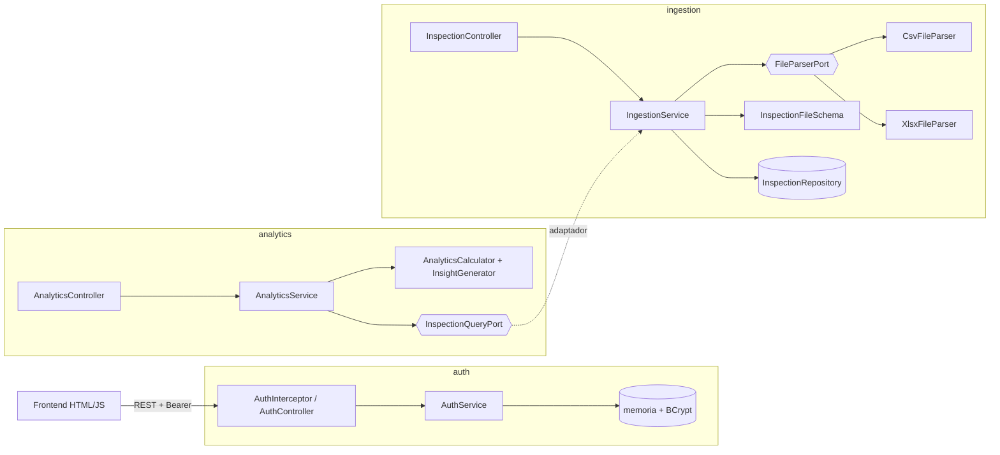

# Analíticas Trace — Prueba técnica

Prototipo funcional (PoC) para supervisar operaciones críticas de campo:
autenticación simulada, ingesta de reportes de inspección (`.csv` / `.xlsx`),
tabla de control, gráficas y análisis descriptivo generado automáticamente.

| Capa | Tecnología |
|---|---|
| Backend | Java 21 · Spring Boot 4.1 (Web MVC, Validation) · Maven Wrapper |
| Lectura de archivos | Apache Commons CSV · Apache POI |
| Documentación API | OpenAPI 3.1 con springdoc (Swagger UI) |
| Frontend | HTML + CSS + JavaScript (módulos ES nativos, sin framework) · Chart.js |
| Pruebas | JUnit 5 · AssertJ · MockMvc |

## Cómo ejecutarlo

Requisito: **JDK 21** (`java -version`). Maven no hace falta; lo descarga `mvnw`.

```bash
./mvnw spring-boot:run          # Windows: mvnw.cmd spring-boot:run
```

| Recurso | URL |
|---|---|
| Aplicación | http://localhost:8080 |
| Swagger UI | http://localhost:8080/swagger-ui.html |
| Especificación OpenAPI | http://localhost:8080/v3/api-docs (copia versionada en [`docs/openapi.yaml`](docs/openapi.yaml)) |

Credenciales de demostración: **admin / admin123** (configurables en `application.properties`).

Pruebas:

```bash
./mvnw test
```

### Archivos de ejemplo (`samples/`)

| Archivo | Qué demuestra |
|---|---|
| `inspecciones.csv` / `inspecciones.xlsx` | Carga correcta de 20 registros |
| `inspecciones_con_errores.csv` | Separador `;`, encabezado con tilde, y 4 filas inválidas que se descartan y reportan (fecha imposible, campo vacío, estado mal escrito, ID duplicado) |
| `inspecciones_esquema_invalido.csv` | Rechazo del archivo completo por columnas faltantes (HTTP 422) |

### Esquema esperado del archivo

| Columna | Obligatoria | Regla |
|---|---|---|
| ID | Sí | Único dentro del archivo |
| Fecha | Sí | `AAAA-MM-DD` o `DD/MM/AAAA` (validación estricta) |
| Ubicacion | Sí | Texto |
| Estado | Sí | `Aprobado`, `Rechazado` o `Pendiente` (sin distinguir mayúsculas ni tildes) |
| Inspector | No | Texto |
| Observaciones | No | Texto |

Los encabezados se reconocen sin importar mayúsculas ni tildes (`Ubicación` = `ubicacion`).
Los CSV pueden usar `,` o `;` (se detecta automáticamente) y traer BOM de Excel.

## Arquitectura

**Hexagonal (puertos y adaptadores) con organización por funcionalidad.** Cada
funcionalidad tiene tres anillos y las dependencias siempre apuntan hacia el dominio:

```
co.analiticas.trace
├── auth/                 Autenticación
│   ├── domain/           User, Credentials, AuthToken, excepciones
│   ├── application/      port/in (LoginUseCase, ValidateTokenUseCase, LogoutUseCase)
│   │                     port/out (UserRepositoryPort, TokenStorePort, PasswordHasherPort)
│   │                     service/AuthService
│   └── infrastructure/   in/web (AuthController, AuthInterceptor) · out (memoria, BCrypt) · config
├── ingestion/            Ingesta de archivos
│   ├── domain/           InspectionRecord, InspectionStatus, InspectionFileSchema (reglas), RawTable
│   ├── application/      port/in (UploadFileUseCase, ListInspectionsUseCase)
│   │                     port/out (FileParserPort, InspectionRepositoryPort) · service/IngestionService
│   └── infrastructure/   in/web (InspectionController) · out (CsvFileParser, XlsxFileParser, memoria)
├── analytics/            Analítica descriptiva
│   ├── domain/           AnalyticsCalculator, InsightGenerator (reglas de hallazgos), InspectionFact
│   ├── application/      port/in (GetAnalyticsUseCase) · port/out (InspectionQueryPort)
│   └── infrastructure/   in/web (AnalyticsController) · out (IngestionInspectionQueryAdapter)
└── shared/               DomainException, GlobalExceptionHandler + ApiError, WebConfig, OpenApiConfig
```



### Decisiones de diseño

- **Dominio y aplicación sin Spring.** Los servicios son clases Java puras; se ensamblan en
  `infrastructure/config/*Config`. Eso los hace probables con pruebas unitarias simples.
- **Strategy para los formatos.** `FileParserPort` tiene un adaptador por formato. Los parsers solo
  leen (`RawTable`); las reglas del negocio viven en `InspectionFileSchema`. Agregar `.json` o `.xls`
  es un adaptador nuevo, sin tocar el dominio ni el servicio.
- **Analítica desacoplada de la ingesta.** La analítica define su propio modelo (`InspectionFact`) y
  su puerto de salida. El único punto de contacto es `IngestionInspectionQueryAdapter`, en infraestructura.
- **Persistencia en memoria detrás de puertos.** Cambiar a JPA o a otra fuente es escribir un adaptador.
- **Autenticación simple pero correcta para un PoC.** Contraseña con hash BCrypt, token UUID con
  expiración (60 min), mismo mensaje para usuario inexistente o clave errada, e interceptor en `/api/**`.
  En producción se reemplazaría por Spring Security + OAuth2/JWT sin tocar los casos de uso.
- **Carga parcial.** Si las columnas son correctas, las filas válidas se cargan y las inválidas se
  reportan con fila, columna y motivo. Si faltan columnas o ninguna fila es válida, se rechaza el archivo.
- **Reloj inyectable (`Clock`)** para probar la expiración de sesiones.

### Manejo de errores

Todas las respuestas de error usan el mismo formato `ApiError`:

```json
{ "status": 422, "code": "INVALID_FILE_CONTENT",
  "message": "El archivo no cumple con el esquema esperado: faltan columnas obligatorias.",
  "details": ["Columnas faltantes: ID, Ubicacion, Estado", "..."],
  "path": "/api/inspections/upload", "timestamp": "2026-11-03T20:00:00Z" }
```

| Caso | HTTP | Código |
|---|---|---|
| Campos de login vacíos | 400 | `VALIDATION_ERROR` |
| Usuario o contraseña incorrectos | 401 | `INVALID_CREDENTIALS` |
| Sin token, token inválido o expirado | 401 | `UNAUTHORIZED` |
| Extensión no soportada | 400 | `UNSUPPORTED_FILE_TYPE` |
| Archivo vacío, dañado o ilegible | 400 | `INVALID_FILE` |
| No se adjuntó archivo | 400 | `FILE_REQUIRED` |
| Archivo mayor a 5 MB | 413 | `FILE_TOO_LARGE` |
| Faltan columnas o ninguna fila es válida | 422 | `INVALID_FILE_CONTENT` |
| Filas con errores (carga parcial) | 200 | Detalle en `errors[]` |

El frontend también valida antes de enviar (campos vacíos, extensión, tamaño). Si recibe un 401,
cierra la sesión y redirige al login.

## Frontend

Archivos estáticos servidos por el mismo Spring Boot (`src/main/resources/static`), también
organizados por funcionalidad:

```
static/
├── index.html · login.html · dashboard.html
├── css/        base.css (tokens) · components.css · pages.css
└── js/
    ├── core/       apiClient.js (fetch + token + ApiError) · session.js · store.js (pub/sub) · dom.js
    ├── auth/       loginController.js
    ├── ingestion/  uploader.js (arrastrar y soltar, validación previa, errores por fila)
    ├── table/      dataTable.js (búsqueda, filtro por estado, orden por columna, paginación)
    ├── analytics/  chartView.js (Chart.js) · summaryView.js (KPIs + hallazgos)
    └── pages/      landing.js · dashboard.js (conecta el estado con los componentes)
```

Todo el texto dinámico se inserta con `textContent` (sin `innerHTML`) para evitar inyección de HTML
con datos del archivo.

## Análisis descriptivo automático

`InsightGenerator` produce un resumen principal (por ejemplo: *"Se procesaron 20 registros: el 60% se
encuentra en estado Aprobado, siendo Frente Norte la zona con mayor actividad."*) y hallazgos:

- distribución porcentual por estado;
- zona con mayor actividad y su participación (o el empate, si lo hay);
- alerta si la tasa de rechazo es del 30% o más, y la zona con más rechazos;
- inspecciones pendientes de cierre;
- periodo analizado (primera y última fecha).

## Nota para Windows

Si la carpeta del usuario tiene espacios o puntos (por ejemplo `C:\Users\EMPRESA S.A.S`), Java no
puede crear sus sockets internos en TEMP y Tomcat falla con *"Unable to establish loopback connection"*.
El `pom.xml` incluye un perfil que se activa solo en Windows y pasa
`-Djdk.net.unixdomain.tmpdir=%PUBLIC%` a `spring-boot:run`. Si se ejecuta el `.jar` directamente:

```bash
java -Djdk.net.unixdomain.tmpdir=C:/Users/Public -jar target/analiticas-trace-0.0.1-SNAPSHOT.jar
```

Si un antivirus inspecciona HTTPS (por ejemplo Avast) y Maven falla con `PKIX path building failed`,
se puede usar el almacén de certificados de Windows:

```bash
set MAVEN_OPTS=-Djavax.net.ssl.trustStoreType=Windows-ROOT
```
