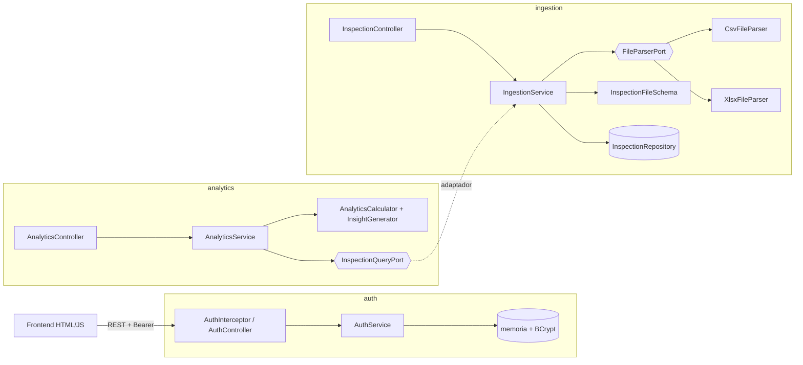

# Analíticas Trace — Prueba técnica

Prototipo funcional (PoC) para supervisar operaciones críticas de campo:
autenticación simulada, ingesta de reportes de inspección (`.csv` / `.xlsx`),
tabla de control, gráficas y análisis descriptivo generado automáticamente.

| Capa | Tecnología |
|---|---|
| Backend | Java 21 · Spring Boot 4.1 (Web MVC, Validation) · Maven Wrapper |
| Lectura de archivos | Apache Commons CSV · Apache POI |
| Documentación API | OpenAPI 3.1 con springdoc (Swagger UI) |
| Frontend | HTML + CSS + JavaScript (módulos ES nativos, sin framework) · Chart.js |
| Pruebas | JUnit 5 · AssertJ · MockMvc |

## Credenciales de acceso

| Usuario | Contraseña | Uso |
|---|---|---|
| `admin` | `admin123` | Login de la aplicación web y de la API (`POST /api/auth/login`) |

- Son **credenciales simuladas** para el prototipo. Se definen en
  [`application.properties`](src/main/resources/application.properties)
  (`trace.auth.default-username` / `trace.auth.default-password`) y se pueden sobrescribir al arrancar:
  `--trace.auth.default-password=otraClave`.
- Al iniciar, la contraseña se guarda **con hash BCrypt** en memoria; nunca se compara en texto plano.
- El login devuelve un **token Bearer válido por 60 minutos** (`trace.auth.token-ttl-minutes`).
  Todas las rutas `/api/**` lo exigen, salvo `/api/auth/login`.
- En Swagger UI: ejecute `POST /api/auth/login`, copie el `token` y péguelo en el botón **Authorize**.
- Las sesiones y los datos cargados viven en memoria: **al reiniciar la aplicación se pierden**.

## Cómo ejecutarlo

Requisito: **JDK 21** (`java -version`). Maven no hace falta; lo descarga `mvnw`.

```bash
./mvnw spring-boot:run          # Windows: mvnw.cmd spring-boot:run
```

| Recurso | URL |
|---|---|
| Aplicación | http://localhost:8080 |
| Swagger UI | http://localhost:8080/swagger-ui.html |
| Especificación OpenAPI | http://localhost:8080/v3/api-docs (copia versionada en [`docs/openapi.yaml`](docs/openapi.yaml)) |

Ingrese con **admin / admin123** (ver [Credenciales de acceso](#credenciales-de-acceso)).

Pruebas:

```bash
./mvnw test
```

### Archivos de ejemplo (`samples/`)

| Archivo | Qué demuestra |
|---|---|
| `inspecciones.csv` / `inspecciones.xlsx` | Carga correcta de 20 registros |
| `inspecciones_con_errores.csv` | Separador `;`, encabezado con tilde, y 4 filas inválidas que se descartan y reportan (fecha imposible, campo vacío, estado mal escrito, ID duplicado) |
| `inspecciones_esquema_invalido.csv` | Rechazo del archivo completo por columnas faltantes (HTTP 422) |
| `inspecciones_mixto_34.csv` | 34 registros: 22 válidos y 12 inválidos (13 errores; una fila tiene dos). La columna *Observaciones* explica qué prueba cada fila |

**La carga no se detiene en el primer error.** Se validan todas las filas, se cargan las válidas y al
final se devuelven todos los errores juntos, con fila, columna y motivo. Solo se rechaza el archivo
completo si faltan columnas obligatorias o si ninguna fila es válida.

### API con `curl`

```bash
# 1. Login: guarda el token
TOKEN=$(curl -s -X POST http://localhost:8080/api/auth/login \
  -H "Content-Type: application/json" \
  -d '{"username":"admin","password":"admin123"}' | sed 's/.*"token":"\([^"]*\)".*/\1/')

# 2. Cargar un archivo
curl -X POST http://localhost:8080/api/inspections/upload \
  -H "Authorization: Bearer $TOKEN" -F "file=@samples/inspecciones_mixto_34.csv"

# 3. Consultar registros y analítica
curl -H "Authorization: Bearer $TOKEN" http://localhost:8080/api/inspections
curl -H "Authorization: Bearer $TOKEN" http://localhost:8080/api/analytics
```

| Método | Ruta | Token | Descripción |
|---|---|---|---|
| POST | `/api/auth/login` | No | Devuelve `{token, username, expiresAt}` |
| POST | `/api/auth/logout` | Sí | Invalida el token |
| POST | `/api/inspections/upload` | Sí | `multipart/form-data`, campo `file` (.csv / .xlsx, máx. 5 MB) |
| GET | `/api/inspections` | Sí | Registros válidos de la última carga |
| GET | `/api/analytics` | Sí | Distribuciones, periodo, resumen y hallazgos |

### Esquema esperado del archivo

| Columna | Obligatoria | Regla |
|---|---|---|
| ID | Sí | Único dentro del archivo |
| Fecha | Sí | `AAAA-MM-DD` o `DD/MM/AAAA` (validación estricta) |
| Ubicacion | Sí | Texto |
| Estado | Sí | `Aprobado`, `Rechazado` o `Pendiente` (sin distinguir mayúsculas ni tildes) |
| Inspector | No | Texto |
| Observaciones | No | Texto |

Los encabezados se reconocen sin importar mayúsculas ni tildes (`Ubicación` = `ubicacion`).
Los CSV pueden usar `,` o `;` (se detecta automáticamente) y traer BOM de Excel.

## Arquitectura

**Hexagonal (puertos y adaptadores) con organización por funcionalidad.** Cada
funcionalidad tiene tres anillos y las dependencias siempre apuntan hacia el dominio:

```
co.analiticas.trace
├── auth/                 Autenticación
│   ├── domain/           User, Credentials, AuthToken, excepciones
│   ├── application/      port/in (LoginUseCase, ValidateTokenUseCase, LogoutUseCase)
│   │                     port/out (UserRepositoryPort, TokenStorePort, PasswordHasherPort)
│   │                     service/AuthService
│   └── infrastructure/   in/web (AuthController, AuthInterceptor) · out (memoria, BCrypt) · config
├── ingestion/            Ingesta de archivos
│   ├── domain/           InspectionRecord, InspectionStatus, InspectionFileSchema (reglas), RawTable
│   ├── application/      port/in (UploadFileUseCase, ListInspectionsUseCase)
│   │                     port/out (FileParserPort, InspectionRepositoryPort) · service/IngestionService
│   └── infrastructure/   in/web (InspectionController) · out (CsvFileParser, XlsxFileParser, memoria)
├── analytics/            Analítica descriptiva
│   ├── domain/           AnalyticsCalculator, InsightGenerator (reglas de hallazgos), InspectionFact
│   ├── application/      port/in (GetAnalyticsUseCase) · port/out (InspectionQueryPort)
│   └── infrastructure/   in/web (AnalyticsController) · out (IngestionInspectionQueryAdapter)
└── shared/               DomainException, GlobalExceptionHandler + ApiError, WebConfig, OpenApiConfig
```



### Decisiones de diseño

- **Dominio y aplicación sin Spring.** Los servicios son clases Java puras; se ensamblan en
  `infrastructure/config/*Config`. Eso los hace probables con pruebas unitarias simples.
- **Strategy para los formatos.** `FileParserPort` tiene un adaptador por formato. Los parsers solo
  leen (`RawTable`); las reglas del negocio viven en `InspectionFileSchema`. Agregar `.json` o `.xls`
  es un adaptador nuevo, sin tocar el dominio ni el servicio.
- **Analítica desacoplada de la ingesta.** La analítica define su propio modelo (`InspectionFact`) y
  su puerto de salida. El único punto de contacto es `IngestionInspectionQueryAdapter`, en infraestructura.
- **Persistencia en memoria detrás de puertos.** Cambiar a JPA o a otra fuente es escribir un adaptador.
- **Autenticación simple pero correcta para un PoC.** Contraseña con hash BCrypt, token UUID con
  expiración (60 min), mismo mensaje para usuario inexistente o clave errada, e interceptor en `/api/**`.
  En producción se reemplazaría por Spring Security + OAuth2/JWT sin tocar los casos de uso.
- **Carga parcial.** Si las columnas son correctas, las filas válidas se cargan y las inválidas se
  reportan con fila, columna y motivo. Si faltan columnas o ninguna fila es válida, se rechaza el archivo.
- **Reloj inyectable (`Clock`)** para probar la expiración de sesiones.

## Guía para entender el código

### Cómo leer un módulo

Cada funcionalidad se lee de adentro hacia afuera:

| Capa | Paquete | Qué contiene | Depende de |
|---|---|---|---|
| Dominio | `<funcionalidad>/domain` | Modelos y reglas de negocio en Java puro | Nada |
| Aplicación | `<funcionalidad>/application/port/in` | Casos de uso que ofrece el módulo (interfaces) | Dominio |
| | `<funcionalidad>/application/port/out` | Lo que el módulo necesita del exterior (interfaces) | Dominio |
| | `<funcionalidad>/application/service` | Implementa los casos de uso usando los puertos de salida | Dominio, puertos |
| Infraestructura | `<funcionalidad>/infrastructure/in/web` | Controladores REST y DTOs (adaptadores de entrada) | Puertos de entrada |
| | `<funcionalidad>/infrastructure/out` | Memoria, BCrypt, CSV, Excel (adaptadores de salida) | Puertos de salida |
| | `<funcionalidad>/infrastructure/config` | Crea los servicios como beans de Spring | Todo lo anterior |

Orden de lectura recomendado: 1) `shared/domain/DomainException`, 2) `auth`, 3) `ingestion`,
4) `analytics`, 5) `shared/error/GlobalExceptionHandler`, 6) el frontend en `static/js/pages/dashboard.js`.

### Recorrido de una petición

**Login** — `POST /api/auth/login`

1. [`AuthController`](src/main/java/co/analiticas/trace/auth/infrastructure/in/web/AuthController.java)
   valida el JSON (`@NotBlank`) y crea `Credentials`.
2. [`AuthService.login`](src/main/java/co/analiticas/trace/auth/application/service/AuthService.java)
   busca el usuario (`UserRepositoryPort`), compara el hash (`PasswordHasherPort`) y guarda un
   `AuthToken` con expiración (`TokenStorePort`).
3. Si falla, lanza `InvalidCredentialsException` → `GlobalExceptionHandler` responde 401.

**Petición protegida** — cualquier `/api/**`

1. [`AuthInterceptor`](src/main/java/co/analiticas/trace/auth/infrastructure/in/web/AuthInterceptor.java)
   (registrado en [`WebConfig`](src/main/java/co/analiticas/trace/shared/config/WebConfig.java))
   lee el encabezado `Authorization: Bearer ...` y llama a `ValidateTokenUseCase`.
2. Si el token no existe o expiró, se lanza `UnauthorizedException` → 401, y el frontend redirige al login.

**Carga de archivo** — `POST /api/inspections/upload`

1. [`InspectionController`](src/main/java/co/analiticas/trace/ingestion/infrastructure/in/web/InspectionController.java)
   recibe el `MultipartFile` y crea un `UploadFileCommand`.
2. [`IngestionService.upload`](src/main/java/co/analiticas/trace/ingestion/application/service/IngestionService.java)
   comprueba que no esté vacío y elige el parser según la extensión (`FileParserPort.supports`).
3. [`CsvFileParser`](src/main/java/co/analiticas/trace/ingestion/infrastructure/out/CsvFileParser.java) o
   [`XlsxFileParser`](src/main/java/co/analiticas/trace/ingestion/infrastructure/out/XlsxFileParser.java)
   solo leen el formato y devuelven una `RawTable` (encabezados + filas de texto).
4. [`InspectionFileSchema.validate`](src/main/java/co/analiticas/trace/ingestion/domain/InspectionFileSchema.java)
   aplica las reglas: columnas obligatorias, fechas, estados, IDs únicos. Acumula los errores sin detenerse.
5. El servicio reemplaza los datos en `InspectionRepositoryPort` y el controlador responde `UploadResponse`.

**Analítica** — `GET /api/analytics`

1. [`AnalyticsService`](src/main/java/co/analiticas/trace/analytics/application/service/AnalyticsService.java)
   pide los datos a `InspectionQueryPort`.
2. [`IngestionInspectionQueryAdapter`](src/main/java/co/analiticas/trace/analytics/infrastructure/out/IngestionInspectionQueryAdapter.java)
   los obtiene de la ingesta y los traduce a `InspectionFact` (el modelo propio de la analítica).
3. [`AnalyticsCalculator`](src/main/java/co/analiticas/trace/analytics/domain/AnalyticsCalculator.java)
   cuenta por estado y ubicación, y
   [`InsightGenerator`](src/main/java/co/analiticas/trace/analytics/domain/InsightGenerator.java)
   redacta el resumen y los hallazgos.

**En el navegador** — [`dashboard.js`](src/main/resources/static/js/pages/dashboard.js)

1. Verifica la sesión (`session.require()`), crea el `store` y los componentes.
2. `uploader.js` valida extensión y tamaño, llama a `api.uploadFile` y muestra el resultado o los errores.
3. Tras la carga, `refresh()` pide `/api/inspections` y `/api/analytics`, actualiza el `store` y este
   notifica a la tabla, las gráficas, los KPIs y el resumen.

### Cómo extenderlo

| Necesidad | Qué hacer | Qué no cambia |
|---|---|---|
| Nuevo formato (`.json`, `.xls`) | Una clase `@Component` que implemente `FileParserPort` | Dominio, servicio, controlador |
| Base de datos real | Un adaptador JPA que implemente `InspectionRepositoryPort` | Dominio, servicio |
| Usuarios reales (BD, LDAP) | Un adaptador que implemente `UserRepositoryPort` | `AuthService`, controlador |
| Nueva columna obligatoria | Agregarla en `InspectionFileSchema` e `InspectionRecord` | Parsers |
| Nuevo hallazgo automático | Una regla en `InsightGenerator.insights()` | Controladores, frontend |
| Nuevo error HTTP | Una excepción que extienda `DomainException` y su estado en `GlobalExceptionHandler` | Formato `ApiError` |

### Dónde están las pruebas

| Prueba | Qué cubre |
|---|---|
| `auth/application/service/AuthServiceTest` | Login, clave errada, usuario inexistente, expiración y logout (con reloj controlado) |
| `ingestion/domain/InspectionFileSchemaTest` | Reglas del esquema: encabezados, errores por fila, archivo sin filas válidas |
| `ingestion/infrastructure/out/FileParsersTest` | CSV con comas/`;`/BOM/comillas, Excel con fechas, archivos dañados |
| `analytics/domain/AnalyticsCalculatorTest` | Resumen, porcentajes, empates, alerta de rechazos, datos vacíos |
| `AnaliticasTraceApplicationTests` | Integración de punta a punta con MockMvc, incluida la documentación OpenAPI |

### Manejo de errores

Todas las respuestas de error usan el mismo formato `ApiError`:

```json
{ "status": 422, "code": "INVALID_FILE_CONTENT",
  "message": "El archivo no cumple con el esquema esperado: faltan columnas obligatorias.",
  "details": ["Columnas faltantes: ID, Ubicacion, Estado", "..."],
  "path": "/api/inspections/upload", "timestamp": "2026-11-03T20:00:00Z" }
```

| Caso | HTTP | Código |
|---|---|---|
| Campos de login vacíos | 400 | `VALIDATION_ERROR` |
| Usuario o contraseña incorrectos | 401 | `INVALID_CREDENTIALS` |
| Sin token, token inválido o expirado | 401 | `UNAUTHORIZED` |
| Extensión no soportada | 400 | `UNSUPPORTED_FILE_TYPE` |
| Archivo vacío, dañado o ilegible | 400 | `INVALID_FILE` |
| No se adjuntó archivo | 400 | `FILE_REQUIRED` |
| Archivo mayor a 5 MB | 413 | `FILE_TOO_LARGE` |
| Faltan columnas o ninguna fila es válida | 422 | `INVALID_FILE_CONTENT` |
| Filas con errores (carga parcial) | 200 | Detalle en `errors[]` |

El frontend también valida antes de enviar (campos vacíos, extensión, tamaño). Si recibe un 401,
cierra la sesión y redirige al login.

## Frontend

Archivos estáticos servidos por el mismo Spring Boot (`src/main/resources/static`), también
organizados por funcionalidad:

```
static/
├── index.html · login.html · dashboard.html
├── css/        base.css (tokens) · components.css · pages.css
└── js/
    ├── core/       apiClient.js (fetch + token + ApiError) · session.js · store.js (pub/sub) · dom.js
    ├── auth/       loginController.js
    ├── ingestion/  uploader.js (arrastrar y soltar, validación previa, errores por fila)
    ├── table/      dataTable.js (búsqueda, filtro por estado, orden por columna, paginación)
    ├── analytics/  chartView.js (Chart.js) · summaryView.js (KPIs + hallazgos)
    └── pages/      landing.js · dashboard.js (conecta el estado con los componentes)
```

Todo el texto dinámico se inserta con `textContent` (sin `innerHTML`) para evitar inyección de HTML
con datos del archivo.

## Análisis descriptivo automático

`InsightGenerator` produce un resumen principal (por ejemplo: *"Se procesaron 20 registros: el 60% se
encuentra en estado Aprobado, siendo Frente Norte la zona con mayor actividad."*) y hallazgos:

- distribución porcentual por estado;
- zona con mayor actividad y su participación (o el empate, si lo hay);
- alerta si la tasa de rechazo es del 30% o más, y la zona con más rechazos;
- inspecciones pendientes de cierre;
- periodo analizado (primera y última fecha).

## Nota para Windows

Si la carpeta del usuario tiene espacios o puntos (por ejemplo `C:\Users\EMPRESA S.A.S`), Java no
puede crear sus sockets internos en TEMP y Tomcat falla con *"Unable to establish loopback connection"*.
El `pom.xml` incluye un perfil que se activa solo en Windows y pasa
`-Djdk.net.unixdomain.tmpdir=%PUBLIC%` a `spring-boot:run`. Si se ejecuta el `.jar` directamente:

```bash
java -Djdk.net.unixdomain.tmpdir=C:/Users/Public -jar target/analiticas-trace-0.0.1-SNAPSHOT.jar
```

Si un antivirus inspecciona HTTPS (por ejemplo Avast) y Maven falla con `PKIX path building failed`,
se puede usar el almacén de certificados de Windows:

```bash
set MAVEN_OPTS=-Djavax.net.ssl.trustStoreType=Windows-ROOT
```
